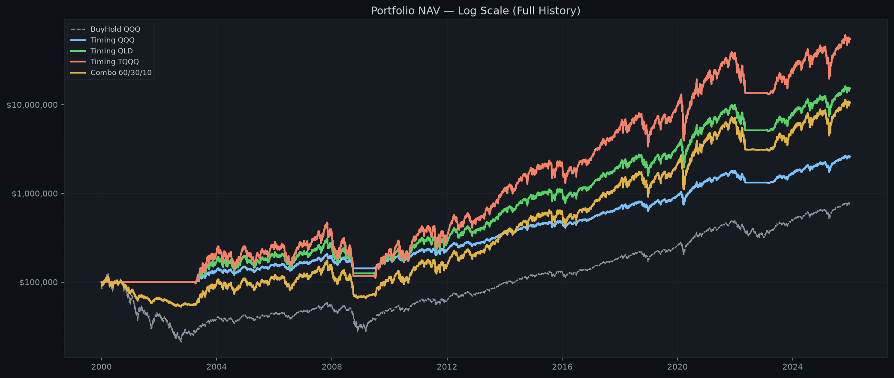
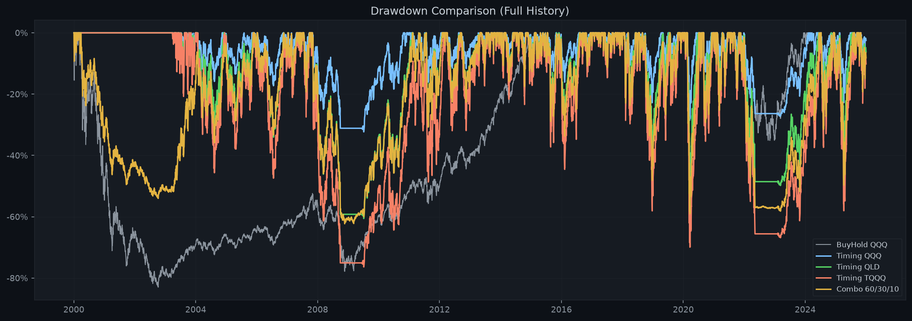
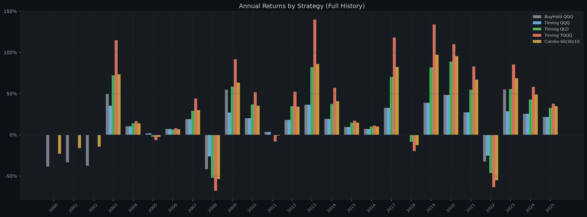
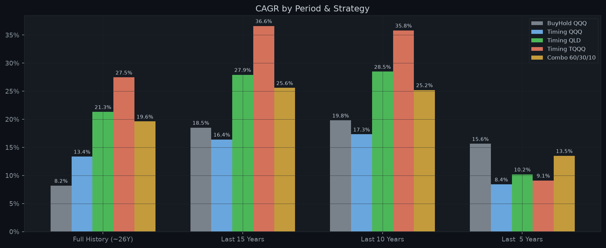
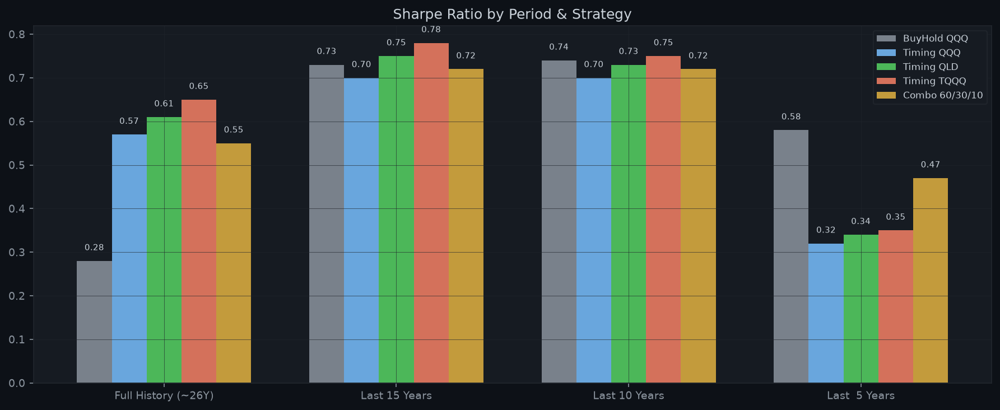

# Multi-Strategy MA200 Backtest Report

**Generated:** 2026-07-25  
**Parameters:** Buy `×1.03` | Sell `×0.83` | MA `225` | Tranches `5` | Dip `-1.0%` | Capital `$100,000`  
**Combo allocation:** QQQ 60% / QLD 30% / TQQQ 10%

---

## Performance Summary / 分周期回测结果

### Full History (~26Y)

| Strategy | Total Return | Final Value | CAGR | Max DD | Sharpe | In Market |
|---|---:|---:|---:|---:|---:|---:|
| **BuyHold QQQ** | +674.01% | $774,014 | +8.19% | -82.96% | 0.28 | 100.0% |
| **Timing QQQ** | +2508.81% | $2,608,806 | +13.37% | -32.32% | 0.57 | 82.0% |
| **Timing QLD** | +15099.50% | $15,199,495 | +21.32% | -60.58% | 0.61 | 82.0% |
| **Timing TQQQ** | +54746.85% | $54,846,845 | +27.46% | -76.37% | 0.65 | 82.0% |
| **Combo 60/30/10** | +10408.94% | $10,508,942 | +19.61% | -62.29% | 0.55 | 82.0% |

### Last 15 Years

| Strategy | Total Return | Final Value | CAGR | Max DD | Sharpe | In Market |
|---|---:|---:|---:|---:|---:|---:|
| **BuyHold QQQ** | +1176.81% | $1,276,809 | +18.52% | -35.12% | 0.73 | 100.0% |
| **Timing QQQ** | +875.82% | $975,820 | +16.41% | -28.56% | 0.70 | 87.3% |
| **Timing QLD** | +3910.87% | $4,010,865 | +27.93% | -51.72% | 0.75 | 87.3% |
| **Timing TQQQ** | +10637.58% | $10,737,584 | +36.61% | -69.92% | 0.78 | 87.3% |
| **Combo 60/30/10** | +2943.10% | $3,043,103 | +25.59% | -51.76% | 0.72 | 87.3% |

### Last 10 Years

| Strategy | Total Return | Final Value | CAGR | Max DD | Sharpe | In Market |
|---|---:|---:|---:|---:|---:|---:|
| **BuyHold QQQ** | +508.21% | $608,205 | +19.81% | -35.12% | 0.74 | 100.0% |
| **Timing QQQ** | +393.14% | $493,142 | +17.32% | -28.56% | 0.70 | 83.5% |
| **Timing QLD** | +1122.22% | $1,222,224 | +28.48% | -51.72% | 0.73 | 83.5% |
| **Timing TQQQ** | +2028.35% | $2,128,348 | +35.82% | -69.92% | 0.75 | 83.5% |
| **Combo 60/30/10** | +844.43% | $944,425 | +25.21% | -47.73% | 0.72 | 83.5% |

### Last  5 Years

| Strategy | Total Return | Final Value | CAGR | Max DD | Sharpe | In Market |
|---|---:|---:|---:|---:|---:|---:|
| **BuyHold QQQ** | +106.36% | $206,364 | +15.64% | -35.12% | 0.58 | 100.0% |
| **Timing QQQ** | +49.66% | $149,660 | +8.42% | -27.20% | 0.32 | 67.3% |
| **Timing QLD** | +62.28% | $162,282 | +10.20% | -49.41% | 0.34 | 67.3% |
| **Timing TQQQ** | +54.41% | $154,415 | +9.11% | -66.12% | 0.35 | 67.3% |
| **Combo 60/30/10** | +87.94% | $187,945 | +13.49% | -41.19% | 0.47 | 67.3% |

---

## Annual Returns (Full History) / 逐年收益

| Year | BuyHold QQQ | Timing QQQ | Timing QLD | Timing TQQQ | Combo 60/30/10 |
|---|---:|---:|---:|---:|---:|
| 2000 | -38.4% | 0.0% | 0.0% | 0.0% | -23.0% |
| 2001 | -33.3% | 0.0% | 0.0% | 0.0% | -16.0% |
| 2002 | -37.4% | 0.0% | 0.0% | 0.0% | -14.2% |
| 2003 | +49.7% | +35.3% | +72.2% | +114.8% | +73.6% |
| 2004 | +10.5% | +10.5% | +14.0% | +16.5% | +13.8% |
| 2005 | +1.6% | +1.6% | -2.5% | -6.2% | -2.4% |
| 2006 | +7.1% | +7.1% | +6.4% | +7.9% | +6.9% |
| 2007 | +19.0% | +19.0% | +29.0% | +44.1% | +29.9% |
| 2008 | -41.7% | -26.1% | -52.2% | -67.8% | -53.7% |
| 2009 | +54.7% | +27.0% | +58.7% | +91.6% | +63.2% |
| 2010 | +20.1% | +20.1% | +36.9% | +51.6% | +35.4% |
| 2011 | +3.5% | +3.5% | 0.0% | -8.0% | -1.0% |
| 2012 | +18.1% | +18.1% | +34.8% | +52.3% | +34.3% |
| 2013 | +36.6% | +36.6% | +82.1% | +139.7% | +85.9% |
| 2014 | +19.2% | +19.2% | +37.6% | +57.1% | +40.6% |
| 2015 | +9.4% | +9.4% | +14.7% | +17.2% | +14.9% |
| 2016 | +7.1% | +7.1% | +10.0% | +11.4% | +10.1% |
| 2017 | +32.7% | +32.7% | +70.3% | +118.1% | +82.4% |
| 2018 | -0.1% | -0.1% | -8.3% | -19.8% | -12.4% |
| 2019 | +39.0% | +39.0% | +81.7% | +133.8% | +97.3% |
| 2020 | +48.4% | +48.4% | +88.9% | +110.1% | +95.6% |
| 2021 | +27.4% | +27.4% | +54.7% | +83.0% | +67.0% |
| 2022 | -32.6% | -25.3% | -46.6% | -63.3% | -55.0% |
| 2023 | +54.9% | +28.6% | +55.7% | +85.5% | +68.7% |
| 2024 | +25.6% | +25.6% | +42.8% | +58.3% | +49.2% |
| 2025 | +21.8% | +21.8% | +32.6% | +37.9% | +34.8% |

---

## Charts / 图表

### NAV Comparison (Log Scale) / 净值曲线对比（对数坐标）

### Drawdown Comparison / 回撤对比

### Annual Returns by Strategy / 逐年收益柱状图

### CAGR by Period / 各时间段年化收益

### Sharpe by Period / 各时间段夏普比率

