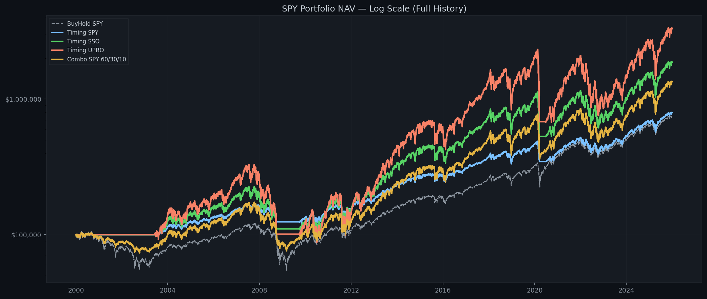
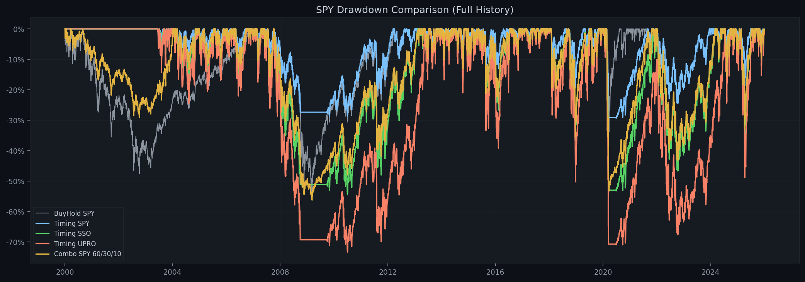
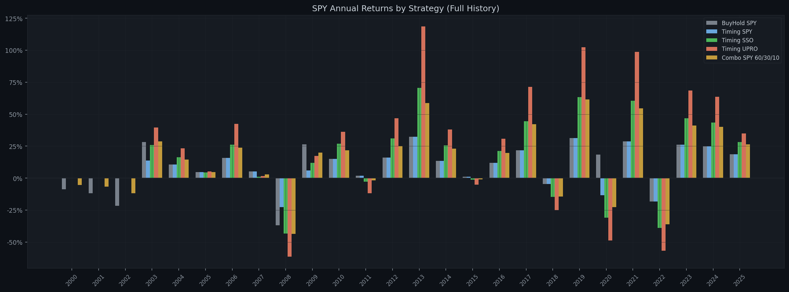
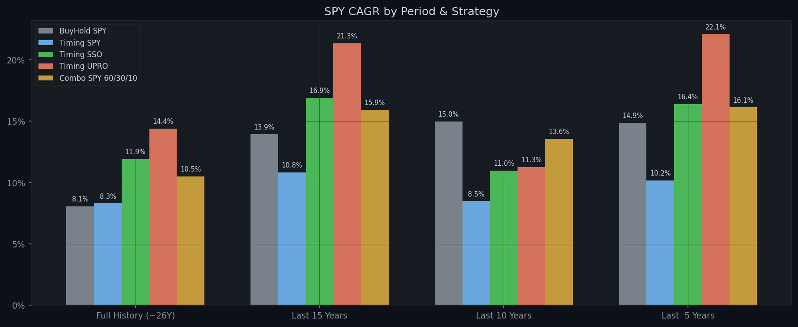
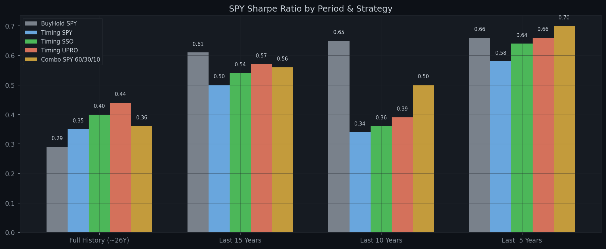

# SPY Multi-Strategy MA Backtest Report

**Generated:** 2026-07-25  
**Parameters:** Buy `×1.03` | Sell `×0.83` | MA `325` | Tranches `5` | Dip `-1.0%` | Capital `$100,000`  
**Combo allocation:** SPY 60% / SSO 30% / UPRO 10%

---

## Performance Summary / 分周期回测结果

### Full History (~26Y)

| Strategy | Total Return | Final Value | CAGR | Max DD | Sharpe | In Market |
|---|---:|---:|---:|---:|---:|---:|
| **BuyHold SPY** | +649.87% | $749,871 | +8.06% | -55.19% | 0.29 | 100.0% |
| **Timing SPY** | +694.57% | $794,573 | +8.30% | -29.38% | 0.35 | 82.0% |
| **Timing SSO** | +1772.02% | $1,872,017 | +11.93% | -54.47% | 0.40 | 82.0% |
| **Timing UPRO** | +3203.47% | $3,303,472 | +14.40% | -73.39% | 0.44 | 82.0% |
| **Combo SPY 60/30/10** | +1241.88% | $1,341,875 | +10.51% | -56.30% | 0.36 | 82.0% |

### Last 15 Years

| Strategy | Total Return | Final Value | CAGR | Max DD | Sharpe | In Market |
|---|---:|---:|---:|---:|---:|---:|
| **BuyHold SPY** | +606.85% | $706,852 | +13.94% | -33.72% | 0.61 | 100.0% |
| **Timing SPY** | +367.94% | $467,935 | +10.84% | -29.38% | 0.50 | 89.2% |
| **Timing SSO** | +939.49% | $1,039,490 | +16.91% | -53.27% | 0.54 | 89.2% |
| **Timing UPRO** | +1716.10% | $1,816,104 | +21.34% | -71.01% | 0.57 | 89.2% |
| **Combo SPY 60/30/10** | +817.57% | $917,569 | +15.94% | -50.21% | 0.56 | 89.2% |

### Last 10 Years

| Strategy | Total Return | Final Value | CAGR | Max DD | Sharpe | In Market |
|---|---:|---:|---:|---:|---:|---:|
| **BuyHold SPY** | +303.24% | $403,241 | +14.98% | -33.72% | 0.65 | 100.0% |
| **Timing SPY** | +125.45% | $225,447 | +8.48% | -29.38% | 0.34 | 83.5% |
| **Timing SSO** | +182.73% | $282,732 | +10.97% | -53.27% | 0.36 | 83.5% |
| **Timing UPRO** | +190.57% | $290,574 | +11.27% | -71.01% | 0.39 | 83.5% |
| **Combo SPY 60/30/10** | +255.82% | $355,822 | +13.55% | -43.37% | 0.50 | 83.5% |

### Last  5 Years

| Strategy | Total Return | Final Value | CAGR | Max DD | Sharpe | In Market |
|---|---:|---:|---:|---:|---:|---:|
| **BuyHold SPY** | +99.56% | $199,563 | +14.87% | -24.50% | 0.66 | 100.0% |
| **Timing SPY** | +62.13% | $162,129 | +10.18% | -18.76% | 0.58 | 52.1% |
| **Timing SSO** | +113.23% | $213,234 | +16.40% | -35.21% | 0.64 | 52.1% |
| **Timing UPRO** | +170.65% | $270,646 | +22.10% | -48.87% | 0.66 | 52.1% |
| **Combo SPY 60/30/10** | +110.77% | $210,773 | +16.13% | -27.36% | 0.70 | 52.1% |

---

## Annual Returns (Full History) / 逐年收益

| Year | BuyHold SPY | Timing SPY | Timing SSO | Timing UPRO | Combo SPY 60/30/10 |
|---|---:|---:|---:|---:|---:|
| 2000 | -8.8% | 0.0% | 0.0% | 0.0% | -5.3% |
| 2001 | -11.8% | 0.0% | 0.0% | 0.0% | -6.8% |
| 2002 | -21.6% | 0.0% | 0.0% | 0.0% | -11.8% |
| 2003 | +28.2% | +13.8% | +25.8% | +39.5% | +28.7% |
| 2004 | +10.7% | +10.7% | +16.4% | +23.3% | +14.6% |
| 2005 | +4.8% | +4.8% | +4.5% | +5.3% | +4.8% |
| 2006 | +15.8% | +15.8% | +26.0% | +42.4% | +23.7% |
| 2007 | +5.1% | +5.1% | +1.1% | +1.6% | +3.0% |
| 2008 | -36.8% | -22.7% | -43.4% | -61.4% | -43.5% |
| 2009 | +26.4% | +6.1% | +11.9% | +17.4% | +19.8% |
| 2010 | +15.1% | +15.1% | +26.8% | +36.3% | +21.7% |
| 2011 | +1.9% | +1.9% | -2.9% | -11.9% | -1.7% |
| 2012 | +16.0% | +16.0% | +31.0% | +46.8% | +25.1% |
| 2013 | +32.3% | +32.3% | +70.5% | +118.5% | +58.6% |
| 2014 | +13.5% | +13.5% | +25.5% | +38.0% | +23.0% |
| 2015 | +1.2% | +1.2% | -1.2% | -5.2% | -1.1% |
| 2016 | +12.0% | +12.0% | +21.3% | +30.8% | +19.7% |
| 2017 | +21.7% | +21.7% | +44.4% | +71.4% | +42.2% |
| 2018 | -4.6% | -4.6% | -14.6% | -25.1% | -14.3% |
| 2019 | +31.2% | +31.2% | +63.4% | +102.3% | +61.5% |
| 2020 | +18.3% | -13.3% | -31.0% | -48.9% | -22.7% |
| 2021 | +28.7% | +28.7% | +60.6% | +98.6% | +54.5% |
| 2022 | -18.2% | -18.2% | -39.0% | -56.8% | -36.1% |
| 2023 | +26.2% | +26.2% | +46.7% | +68.5% | +41.1% |
| 2024 | +24.9% | +24.9% | +43.5% | +63.6% | +40.0% |
| 2025 | +18.6% | +18.6% | +28.1% | +34.9% | +26.3% |

---

## Charts / 图表

### NAV Comparison (Log Scale) / 净值曲线对比（对数坐标）

### Drawdown Comparison / 回撤对比

### Annual Returns by Strategy / 逐年收益柱状图

### CAGR by Period / 各时间段年化收益

### Sharpe by Period / 各时间段夏普比率

